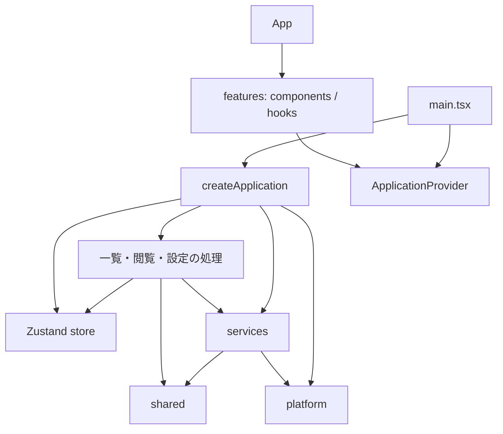

# アーキテクチャ

この文書は、設計上の責務・依存方向を扱います。アプリの機能と使い方は [README.md](README.md)、開発・検証の手順は [CONTRIBUTING.md](CONTRIBUTING.md) を参照してください。具体的な定数、DOM ID、関数の引数などは実装を参照し、ここでは処理を分ける理由と変更時に守る境界を説明します。

## 設計の前提

大量のローカル画像を扱うため、一覧の再描画や画面の切り替えが、ファイルの再走査や画像の再生成につながらないようにします。非同期の読み込みが後から完了する場合も、現在の表示を上書きせず、不要なリソースを解放する必要があります。

このため、画面の寿命、アプリの状態と操作の寿命、キャッシュ・保存処理の寿命を分けます。React コンポーネントの再描画だけでは、サービスの生成・破棄や永続化を行いません。

## 構成と責務

React の画面、操作を調整する処理、キャッシュ・永続化、実行環境の API を分けています。`main.tsx` が `createApplication()` でアプリを一度生成し、`ApplicationProvider` で UI に渡します。モジュールの読み込みだけではストア生成やイベント登録を行いません。

| 配置先                                       | 責務                                                 |
| -------------------------------------------- | ---------------------------------------------------- |
| `app/App.tsx`                                | 各機能の画面を組み立てる                             |
| `app/ApplicationProvider.tsx`                | アプリの提供、状態購読、起動・終了の接続             |
| `app/store.ts`・`viewerModel.ts`・`ports.ts` | 状態の型・初期値、UIとサービスの接点                 |
| `app/create*.ts`                             | 一覧取得・閲覧・表示設定・画面遷移の調整             |
| `features/library/`                          | ホーム、最近使ったフォルダー、お気に入りフォルダー   |
| `features/browsing/`                         | フォルダー操作、表示条件、読み込み状態               |
| `features/gallery/`                          | カード、サムネイルのライフサイクル、仮想一覧との接続 |
| `features/viewer/`                           | 画像・動画・PDFの表示、再生制御、全画面とツールバー  |
| `services/`                                  | ファイル設定、ディレクトリ・画像キャッシュ、Worker   |
| `platform/`                                  | ブラウザー・Electron API、イベント登録、localStorage |
| `shared/`                                    | モデル・共通関数。上位層に依存しない                 |

## 依存方向

機能の UI は `useAppState(selector)` で必要な状態だけを購読し、`useAppActions()` で操作を要求します。ファイルアクセスやキャッシュの具体的な実装を直接 import しません。サムネイル Hook が必要とするメディア操作も、Provider が提供するサービス経由で取得します。

Context が提供するのは同じアプリインスタンスです。ストアの更新ごとに Context の値全体を差し替えず、Zustand の selector で再描画範囲を絞ります。アプリの処理はコンポーネントを import せず、ギャラリーへのスクロール要求や動画の再生位置取得は `ports.ts` のコールバックで受け取ります。DOM ノードをアプリの処理側に保持しません。

ESLint は UI からインフラへの直接依存、サービス・実行環境・共通層からアプリや UI への逆依存、アプリの処理から React への依存を禁止します。`App.tsx` は画面を組み立てるため、機能コンポーネントを import します。

## 状態とリソースの所有

ストアは画面間で共有する状態を持ちます。一覧条件、フォルダー履歴、閲覧状態などが対象です。初期状態の生成はブラウザー API を読みません。保存済みの表示設定は組み立て時に `platform/preferences.ts` から読み、ストアに渡します。

コンポーネント内で完結する状態は、そのコンポーネントか Hook が持ちます。サムネイルの読み込み結果・デコード状態・再試行回数、カード操作中のフラグ、ツールバーの表示タイマーなどです。`useThumbnail` は結果をファイルハンドルと試行番号に結びつけ、変更前の結果が完了しても表示せず、不要な Object URL を解放します。Effect 内で props を状態へコピーしてリセットしません。

画像キャッシュ、ディレクトリキャッシュ、Worker、設定ファイルの保存管理は、単一ウィンドウ内で共有する長寿命のサービスです。React のレンダーごとに生成しません。アプリの終了処理は購読・タイマー・読み込みを解除し、不要なキャッシュを破棄します。StrictMode の再セットアップでもイベントを重複登録しません。アプリの状態と履歴はインスタンスごとですが、これらのサービスは同じ実行環境内で共有します。

フォルダーの代表画像は、一覧表示の読み込み結果から独立した `directoryPreview.ts` が選びます。Web・Electronともに、まずpreferred画像の候補名をハンドルの `getFileHandle()` で直接確認し、なければ有効な保存済みパスを直接取得します。どちらでも決まらなかった場合にだけ `platform/nativeFs.ts` 経由で列挙して探索します。候補名・拡張子の順はREADMEに従い、大小文字の照合は実ファイルシステムに任せます。大小文字を補完するための全件列挙は行いません。`directoryCache.ts` と再帰一覧の走査結果は一覧表示のためだけに使い、代表画像の選択から参照しません。Electronの一覧取得IPCも常に実ファイルシステムを読み、ファイル一覧の永続キャッシュや更新日時による再利用、キャッシュを迂回するためのフラグは持ちません。旧 `directory-cache.json` は読み書きしません。

サムネイル処理が保持するのは「代表ファイルの探索結果パス」と「選択済みファイルの縮小画像」の二種類です。ディレクトリをキーにした画像・URLキャッシュは持ちません。代表ファイルを選択してから、ファイルをキーに既存の縮小画像キャッシュを利用します。返却された Object URL はカードが所有し、読み込みの取り消し・アンマウント時に解放します。

探索結果のパスは `storage.ts` の既存の設定保存に合流させます。アプリがルートハンドルと対象フォルダーの位置を渡し、ルート設定の各ノードに対象フォルダーからの相対パスと1週間の有効期限を保持します。preferred 画像への切り替えも保存済みパスへ反映し、保存済みパスを利用するだけでは期限を延長しません。設定保存の直列化・遅延保存・終了時のフラッシュを共有します。保存済みパスはフォルダー外へ遡らないよう検証し、設定の読み書きに失敗してもプレビュー表示を続けます。

代表ファイルの選択は画像生成とは別のキューで同時実行数を制限し、画面内のカードを先読みより優先します。フォールバックの列挙は最初の直下メディアが見つかった時点で終え、直下にメディアがない場合だけ最初のサブフォルダーへ進みます。画面移動で不要になった探索は候補名の問い合わせ中・列挙中・子フォルダーへ進む前に中止し、途中結果を設定へ保存しません。これにより、移動前の不要な探索が移動先の一覧取得と競合し続けるのを防ぎます。

## アプリ全体の容量設定

`shared/appConfig.ts` が容量設定の型・既定値・入力の正規化を持ちます。`app/createConfig.ts` が読み込み・保存とキャッシュへの反映を調整し、UIはアプリの操作とストアだけを利用します。使用量は設定画面を開いている間だけ更新します。サムネイルと元画像の保持容量は各サービスが管理し、ファイル数では制限しません。

`platform/appConfig.ts` はWeb版のlocalStorageとデスクトップ版のIPCを切り替えます。Electronのメインプロセスが容量設定ファイルとディスクキャッシュを所有し、IPCの値を検証してから保存します。容量設定は閲覧フォルダーの `.image-viewer.json` と独立しています。既存の表示設定の保存規則は維持します。

## 仮想一覧

`virtualGallery.ts` は行の測定・配置と空スロットを管理し、カードの内容は React が Portal で描画します。DOM 所有範囲をこの境界で分け、接続処理を `useVirtualGallery` に閉じ込めています。

レイアウトはファイルハンドルとキーの並びを浅く比較します。お気に入りなどのメタデータだけが変わったときは行を再生成せず、既存カードを更新します。スクロールフレームでは、空スロットが文書の高さを一時的に縮めないよう、全スロットの更新後に一度だけ同期コミットします。このための限定的な `flushSync` は Hook 内に置いています。既存のスクロール回帰テストを変更時の基準にします。

## 機能を追加するとき

見た目と画面内の操作は該当する `features/` に追加します。外部 API との同期は専用 Hook、画面をまたぐ状態や操作の調整は `app/`、ファイル・キャッシュの処理は `services/`、実行環境の API は `platform/` に置きます。機能間でコンポーネントを直接呼び合う代わりに、アプリの操作と共有状態でつなぎます。

## 設計の参照先

[React の Context](https://react.dev/learn/passing-data-deeply-with-context)、[Effect の依存関係](https://react.dev/learn/removing-effect-dependencies)。

## バージョン・配布・更新

`package.json`のバージョンをViteがビルド時に埋め込み、同じ値の `version.json` も出力します。UIはProvider経由で `platform/releases.ts` の購読・更新確認を利用します。Webは配信済み `version.json` を確認するため、未リリースのmainやGitHub APIの状態によって新版を通知しません。起動・終了時の購読とタイマーはアプリのライフサイクルに結び付け、終了前の非同期結果は破棄します。

Electronの更新処理はメインプロセスの `updates.cjs` が所有し、preloadの限定したIPCで状態・確認・インストール要求を提供します。NSISインストーラーだけが配置するマーカーがあるWindowsインストール版でのみ `electron-updater` を起動します。Portable版・展開版・開発起動・macOSでは手動更新にします。更新先は固定のpublic GitHub Releasesで、クライアントに認証情報は保持しません。Windowsは未署名配布のためAuthenticode検証を無効にしますが、更新ライブラリのHTTPS・ファイルハッシュ照合は維持します。

更新ボタンから既存の終了前IPCでルート設定の保存を要求し、成功応答後だけ `quitAndInstall` を呼び出します。終了時の自動インストールは無効化し、保存失敗時はインストール要求を取り消して再試行できるようにします。

正式リリースはmainのバージョン更新コミットに付けたタグへ固定します。全プラットフォームのビルド成功後にReleaseを公開し、同じコミットから検証したWeb成果物を配信します。通常のmainへのpushは配信しません。

## PDFの閲覧

PDFは一覧では1ファイルとして扱い、画像フォルダーの見開き用リストには含めません。`createViewer` が開いたPDFのページ数と閲覧位置を管理し、既存の単一・見開き表示と操作を共有します。`services/pdfDocument.ts` がPDF.jsの遅延ロードとページ描画を担当し、サムネイルには先頭ページを利用します。ページの描画結果は元画像と同じページキャッシュで表示中と近隣ページだけ保持し、閉じるとキャッシュとPDFのWorkerを破棄します。読み込み結果は閲覧セッションに結びつけ、閉じた後や別ファイルに切り替えた後の結果を表示しません。ViteはPDF.jsのCMap・標準フォント・WASMをWeb版とElectron版へ同梱します。
