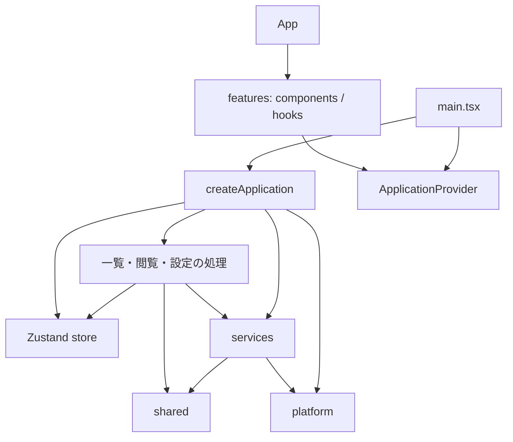

# コードの構成

React の画面、操作を調整する処理、キャッシュ・永続化、実行環境の API を分けています。`main.tsx` が `createApplication()` でアプリを一度生成し、`ApplicationProvider` で UI に渡します。モジュールの読み込みだけではストア生成やイベント登録を行いません。

| 配置先                                       | 責務                                                 |
| -------------------------------------------- | ---------------------------------------------------- |
| `app/App.tsx`                                | 各機能の画面を組み立てる                             |
| `app/ApplicationProvider.tsx`                | アプリの提供、状態購読、起動・終了の接続             |
| `app/store.ts`・`viewerModel.ts`・`ports.ts` | 状態の型・初期値、UIとサービスの接点                 |
| `app/create*.ts`                             | 一覧取得・閲覧・表示設定・画面遷移の調整             |
| `features/library/`                          | ホーム、最近使ったフォルダー、お気に入りフォルダー   |
| `features/browsing/`                         | フォルダー操作、表示条件、読み込み状態               |
| `features/gallery/`                          | カード、サムネイルのライフサイクル、仮想一覧との接続 |
| `features/viewer/`                           | 画像・動画の表示、再生制御、全画面とツールバー       |
| `services/`                                  | ファイル設定、ディレクトリ・画像キャッシュ、Worker   |
| `platform/`                                  | ブラウザー・Electron API、イベント登録、localStorage |
| `shared/`                                    | モデル・共通関数。上位層に依存しない                 |

## 依存方向

機能の UI は `useAppState(selector)` で必要な状態だけを購読し、`useAppActions()` で操作を要求します。ファイルアクセスやキャッシュの具体的な実装を直接 import しません。サムネイル Hook が必要とするメディア操作も、Provider が提供するサービス経由で取得します。

Context が提供するのは同じアプリインスタンスです。ストアの更新ごとに Context の値全体を差し替えず、Zustand の selector で再描画範囲を絞ります。アプリの処理はコンポーネントを import せず、ギャラリーへのスクロール要求や動画の再生位置取得は `ports.ts` のコールバックで受け取ります。DOM ノードをアプリの処理側に保持しません。

ESLint は UI からインフラへの直接依存、サービス・実行環境・共通層からアプリや UI への逆依存、アプリの処理から React への依存を禁止します。`App.tsx` は画面を組み立てるため、機能コンポーネントを import します。

## 状態とリソースの所有

ストアは画面間で共有する状態を持ちます。一覧条件、フォルダー履歴、閲覧状態などが対象です。初期状態の生成はブラウザー API を読みません。保存済みの表示設定は組み立て時に `platform/preferences.ts` から読み、ストアに渡します。

コンポーネント内で完結する状態は、そのコンポーネントか Hook が持ちます。サムネイルの読み込み結果・デコード状態・再試行回数、カード操作中のフラグ、ツールバーの表示タイマーなどです。`useThumbnail` は結果をファイルハンドルと試行番号に結びつけ、変更前の結果が完了しても表示せず、不要な Object URL を解放します。Effect 内で props を状態へコピーしてリセットしません。

画像キャッシュ、ディレクトリキャッシュ、Worker、設定ファイルの保存管理は、単一ウィンドウ内で共有する長寿命のサービスです。React のレンダーごとに生成しません。アプリの終了処理は購読・タイマー・読み込みを解除し、不要なキャッシュを破棄します。StrictMode の再セットアップでもイベントを重複登録しません。アプリの状態と履歴はインスタンスごとですが、これらのサービスは同じ実行環境内で共有します。

## 仮想一覧

`virtualGallery.ts` は行の測定・配置と空スロットを管理し、カードの内容は React が Portal で描画します。DOM 所有範囲をこの境界で分け、接続処理を `useVirtualGallery` に閉じ込めています。

レイアウトはファイルハンドルとキーの並びを浅く比較します。お気に入りなどのメタデータだけが変わったときは行を再生成せず、既存カードを更新します。スクロールフレームでは、空スロットが文書の高さを一時的に縮めないよう、全スロットの更新後に一度だけ同期コミットします。このための限定的な `flushSync` は Hook 内に置いています。既存のスクロール回帰テストを変更時の基準にします。

## 機能を追加するとき

見た目と画面内の操作は該当する `features/` に追加します。外部 API との同期は専用 Hook、画面をまたぐ状態や操作の調整は `app/`、ファイル・キャッシュの処理は `services/`、実行環境の API は `platform/` に置きます。機能間でコンポーネントを直接呼び合う代わりに、アプリの操作と共有状態でつなぎます。

検証は `npm run check`、ブラウザーは `npm run test:e2e`、Electron は `npm run test:desktop` を使います。Provider の状態分離・起動終了の再実行・古いサムネイル結果の破棄は単体テスト、実際のスクロール・ナビゲーション・設定保存は操作テストで確認します。

設計の参照先: [React の Context](https://react.dev/learn/passing-data-deeply-with-context)、[Effect の依存関係](https://react.dev/learn/removing-effect-dependencies)。
